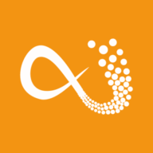
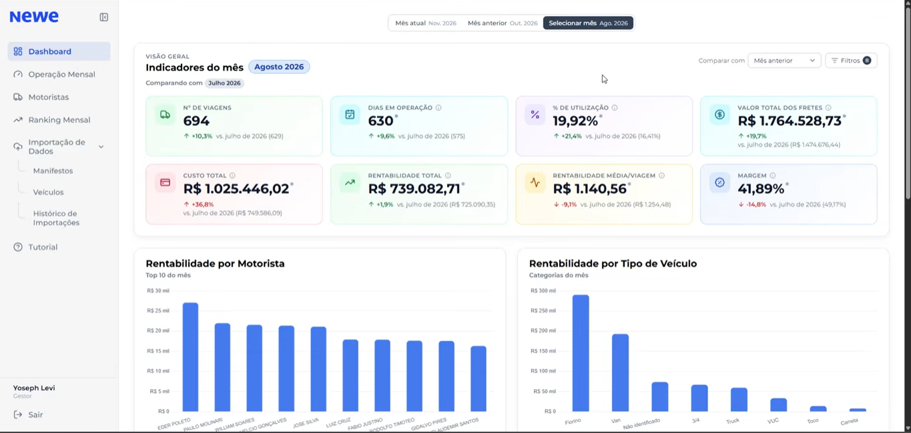
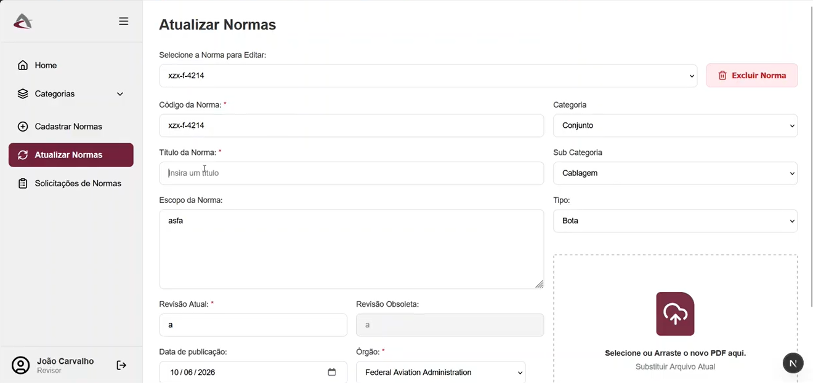
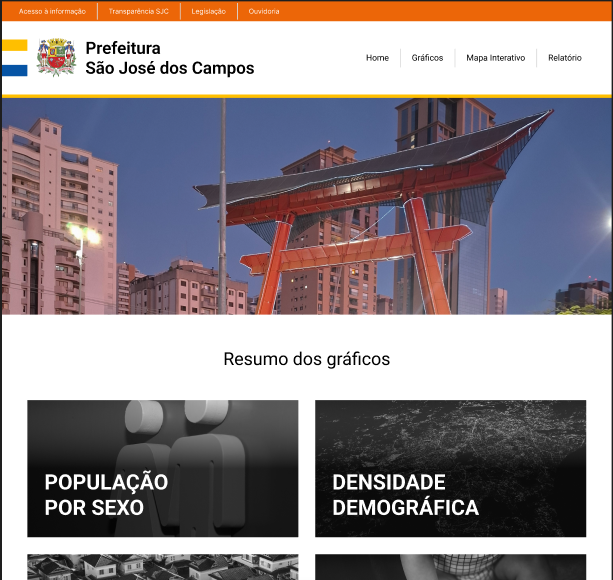
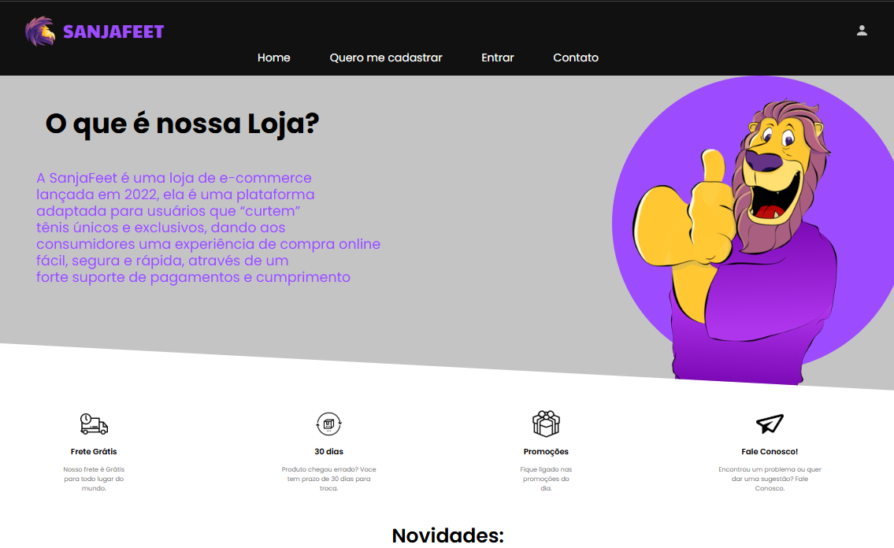
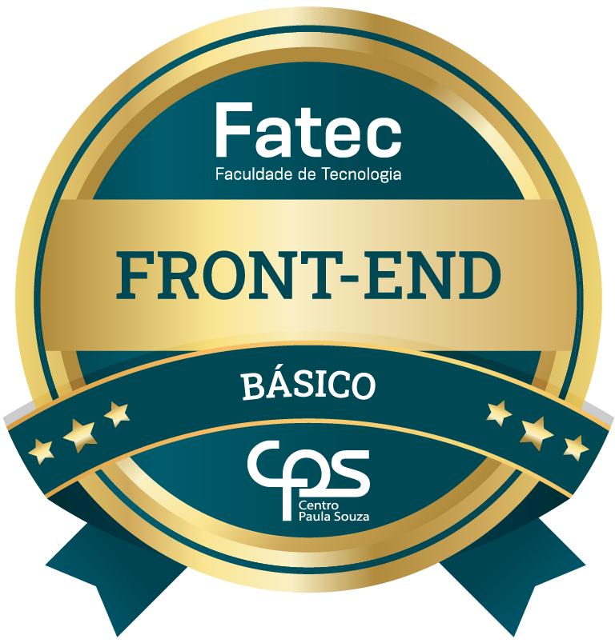
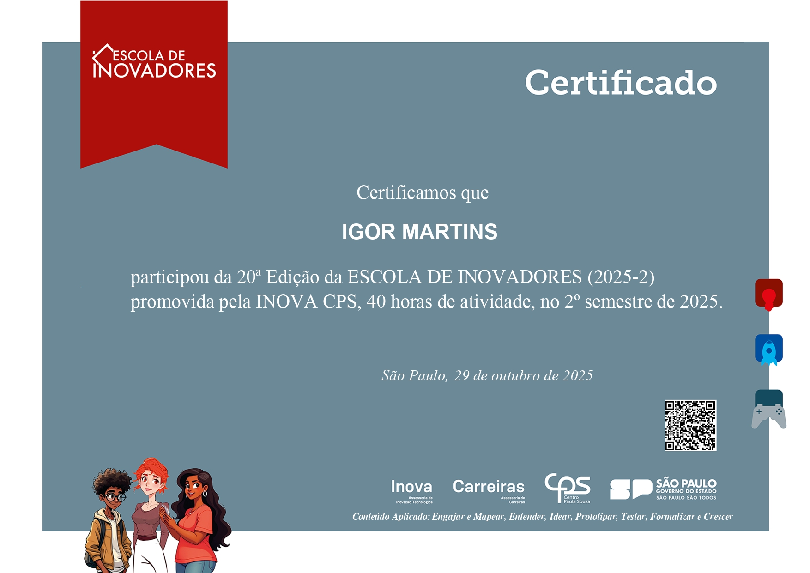
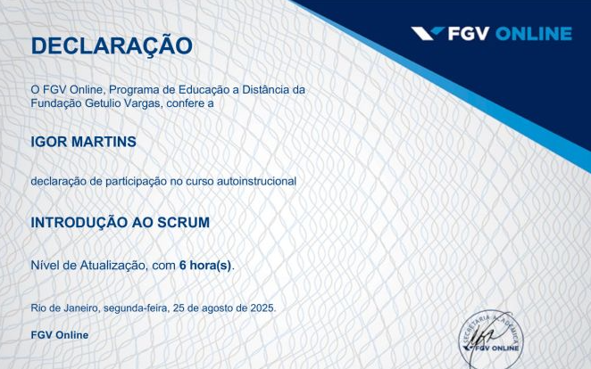

<div align="center">


<br />

<a href="https://igormartins0729.github.io/Portfolio_IgorMartins/"></a>
<a href="https://www.linkedin.com/in/igormrtns/"></a>
<a href="https://github.com/IgorMartins0729"></a>
<a href="mailto:igor.mrt02@gmail.com"></a>

</div>

---

## 👋 Sobre mim


Sou **Igor Martins**, desenvolvedor FullStack e estudante da **FATEC São José dos Campos**. Gosto de entender o problema antes de escrever a primeira linha, e de construir aplicações que sejam simples de usar e de manter, do banco de dados até a interface.

No dia a dia trabalho com desenvolvimento web, versionamento com Git e integração entre front-end e back-end. Sigo aprendendo com projetos acadêmicos e profissionais, sempre buscando escrever código mais limpo e entregar experiências melhores para quem usa.

> *"Make it work, make it right, make it fast."* — Kent Beck

<br clear="right" />

---

## 💼 Experiência profissional

<table>
  <tr>
    <td width="72" align="center"></td>
    <td>
      <b>Estagiário de Desenvolvedor de Software</b> · Kaffa Tech &nbsp;<br />
      <sub>Dez 2025 — Atual</sub>
      <ul>
        <li>Desenvolvimento de telas e componentes em Angular para os sistemas da empresa, voltados ao setor de utilities.</li>
        <li>Criação e manutenção de APIs REST em C# com .NET, integrando o front-end às regras de negócio.</li>
        <li>Escrita e otimização de consultas SQL e ajustes de estrutura no banco de dados Oracle.</li>
        <li>Correção de bugs, participação em code reviews e entregas em sprints com o time.</li>
      </ul>
      
      
      
      
    </td>
  </tr>
  <tr>
    <td align="center"></td>
    <td>
      <b>Auxiliar de T.I</b> · Sonaca Brasil<br />
      <sub>Mar 2024 — Jun 2025</sub>
      <ul>
        <li>Suporte a usuários e manutenção de equipamentos e redes.</li>
        <li>Instalação e configuração de softwares e estações de trabalho.</li>
        <li>Apoio na documentação e organização de processos de T.I.</li>
      </ul>
    </td>
  </tr>
  <tr>
    <td align="center"></td>
    <td>
      <b>Assistente de Service Desk</b> · Atento Brasil<br />
      <sub>Abr 2023 — Mar 2024</sub>
      <ul>
        <li>Atendimento de chamados de suporte técnico de primeiro nível.</li>
        <li>Resolução de problemas de acesso, contas e configurações de usuários.</li>
        <li>Registro e acompanhamento de incidentes até a solução.</li>
      </ul>
    </td>
  </tr>
</table>

---

## 🎓 Formação acadêmica

| | Curso | Instituição | Período | Status |
|:-:|---|---|---|:-:|
| 🎓 | **Tecnólogo em Desenvolvimento de Software Multiplataforma** | FATEC São José dos Campos | Ago 2025 — Jun 2028 (previsão) |  |
| 🏫 | **Ensino Médio / Técnico em Informática** | Colégio Joseense | Jan 2020 — Dez 2022 |  |

<details>
<summary><b>📚 Disciplinas cursadas na FATEC</b></summary>
<br />

`Desenvolvimento Web` `Engenharia de Software` `Banco de Dados Relacional` `Banco de Dados Não Relacional` `Estrutura de Dados` `Técnicas de Programação` `Gestão Ágil de Projetos de Software` `Interação Humano Computador` `Algoritmos e Lógica de Programação` `Modelagem de Banco de Dados` `Design Digital` `Sistemas Operacionais e Redes de Computadores` `Matemática para Computação` `Álgebra Linear` `Inglês`

</details>

---

## 🚀 Projetos

<table>
  <tr>
    <td width="50%" valign="top">
      <a href="https://github.com/FATCK06/ProjectAPI_ThirdSemester"></a>
      <h3>Newe Log</h3>
      <sub>Acadêmico · API 3º semestre · <a href="https://youtu.be/irGgT2lX5-Y">▶ vídeo</a></sub>
      <p>Sistema para gestores da operação logística acompanharem os motoristas agregados: viagens realizadas, disponibilidade e rentabilidade das operações em uma visão simples e organizada.</p>
      <p><b>Minha parte:</b> desenvolvedor full stack — estrutura com API Gateway e microsserviços, autenticação com token em Java, fluxo de importação de planilhas em etapas, gráficos do dashboard, bloqueio de rotas por perfil e responsividade.</p>
      
      
      
      
      
      
      
    </td>
    <td width="50%" valign="top">
      <a href="https://github.com/FATCK06/ProjectAPI_SecondSemester"></a>
      <h3>Akaer</h3>
      <sub>Acadêmico · API 2º semestre · <a href="https://youtu.be/Ylr-959Tl1k">▶ vídeo</a></sub>
      <p>Plataforma web para centralizar, organizar e correlacionar requisitos normativos aeronáuticos, garantindo rastreabilidade e eficiência no processo de conformidade regulatória.</p>
      <p><b>Minha parte:</b> desenvolvedor full stack — base do front-end em React, login com Next.js, sidebar e layouts, página inicial e a funcionalidade de normas correlacionadas.</p>
      
      
      
      
      
      
      
    </td>
  </tr>
  <tr>
    <td width="50%" valign="top">
      <a href="https://github.com/FATCK06/ProjectAPI_FirstSemester"></a>
      <h3>Censo 2022 SJC</h3>
      <sub>Acadêmico · API 1º semestre · <a href="https://www.youtube.com/watch?v=Q94hcJWcIXA">▶ vídeo</a></sub>
      <p>Plataforma interativa que transforma os dados brutos do Censo 2022 em painéis, gráficos e mapas com filtros por região e faixa etária, para a Secretaria de Planejamento Urbano de São José dos Campos.</p>
      <p><b>Minha parte:</b> Scrum Master do time — cerimônias e backlog, estrutura do repositório, header, navbar e home em HTML e CSS, e o README do projeto.</p>
      
      
      
      
      
      
    </td>
    <td width="50%" valign="top">
      <a href="https://github.com/IgorMartins0729/ProjectSanjaFeet_TCCTechnical"></a>
      <h3>TCC Sanja Feet</h3>
      <sub>Acadêmico · TCC do Técnico em Informática</sub>
      <p>Loja virtual de tênis exclusivos, desenvolvida como Trabalho de Conclusão de Curso do Técnico em Informática no Colégio Joseense.</p>
      <p><b>Minha parte:</b> desenvolvimento da loja com PHP no back-end e HTML, CSS e JavaScript no front-end.</p>
      
      
      
      
    </td>
  </tr>
</table>

---

## 🧰 Hard skills

| Categoria | Tecnologias |
|---|---|
| **Front-end** |       |
| **Back-end** |          |
| **Banco de dados** |        |
| **Ferramentas & Infra** |        &nbsp;`Thunder Client` |

## 🤝 Soft skills

`01 Comunicação` `02 Trabalho em equipe` `03 Resolução de problemas` `04 Aprendizado contínuo` `05 Proatividade` `06 Liderança` `07 Empatia` `08 Organização` `09 Gestão de tempo` `10 Criatividade` `11 Resiliência` `12 Responsabilidade` `13 Receptivo a feedback`

---

## 🏅 Certificados

| | Certificado | Instituição | Emissão |
|:-:|---|---|:-:|
|  | **Micro Certificação em Front-End Básico** <br /><sub>Badge digital</sub> | Fatec — Centro Paula Souza | Nov 2026 |
|  | **Escola de Inovadores (20ª Edição)** <br /><sub>40h · <a href="public/certificados/CERTIFICADO_-_2025-2.pdf">PDF</a></sub> | Inova CPS — Centro Paula Souza | Out 2025 |
|  | **Introdução ao Scrum** <br /><sub>6h</sub> | FGV Online | Ago 2025 |

---

## 🛠️ Sobre este repositório

Este repositório é o código do meu portfólio. Ele é uma página única, feita em React, publicada no GitHub Pages.

<p>
  
  
  
  
  
</p>

### ✨ Destaques

- **Hero** com o título animado e centralizado na tela.
- **Timeline de experiência** com painel de detalhes e duração calculada automaticamente.
- **Formação** com barra de progresso do curso calculada pelas datas.
- **Projetos** com filtro por categoria, capas que alternam entre logo e print, e modal com vídeo, imagens e detalhes.
- **Skills** com ícones por categoria, **certificados** com visualização ampliada e **contato** com botão de copiar e-mail.
- **Responsivo** do celular ao desktop, com respeito à preferência de menos animação do sistema.

### 📁 Estrutura

```
src/
├── components/      # Navbar, Footer (contato), BaseModal, CyberBackground
├── data/            # 📝 todo o conteúdo do site, em JSON
├── pages/Home/
│   └── sections/    # Hero, AboutMe, Experience, Academic, Projects, Skills, Certificates
├── services/        # leitura dos JSONs (dataService.ts)
├── types/           # interfaces de cada tipo de dado
└── utils/           # datas ("Dez 2025") e cálculo de períodos
public/              # imagens de projetos, logos de empresas, certificados e currículo
```

### ✏️ Como atualizar o conteúdo

Todo o conteúdo fica em `src/data/`. Não é preciso mexer em componente:

| Arquivo | O que muda |
|---|---|
| `experiencias.json` | empregos (sem `fimPeriodo` = emprego atual) |
| `formacao.json` | cursos e disciplinas cursadas |
| `projetos.json` | projetos: `capa1` (logo), `capa2` (print), `imagens`, `video` e detalhes |
| `habilidades.json` | hard skills por categoria (ícones do [Devicon](https://devicon.dev)) e soft skills |
| `certificados.json` | certificados e badges (`"badge": true`) |

Imagens novas vão em `public/` e são referenciadas no JSON pelo caminho relativo, por exemplo `"projetos/meu-projeto.png"`.

### ▶️ Como rodar

```bash
# instalar as dependências
npm install

# rodar em modo de desenvolvimento
npm run dev

# gerar a versão de produção
npm run build

# publicar no GitHub Pages
npm run deploy
```

---

<div align="center">

### 📬 Vamos construir algo juntos?

Estou aberto a oportunidades, projetos e boas conversas sobre tecnologia.

<a href="mailto:igor.mrt02@gmail.com"></a><a href="https://www.linkedin.com/in/igormrtns/"></a>


</div>
